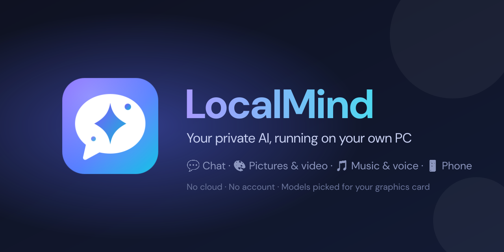

<p align="center"></p>

# LocalMind

LocalMind is a Windows app for running AI on your own PC. It does chat, pictures, short videos, songs and voice,
and it works without internet once the models are downloaded. You don't need an account or a cloud service, and
you don't have to install Python or anything else.

You download one exe, pick a setup that suits your graphics card, and that's it.

## What it does

**Chat.** Runs GGUF models with [llama.cpp](https://github.com/ggml-org/llama.cpp). The Model Manager lists
thousands of models from Hugging Face and by default shows only the ones that fit in your VRAM. Chat supports
attachments (images, PDFs, text), documents with page citations, web search, thinking models, personas, folders
and search. You can also press Ctrl+Alt+Space from anywhere for a quick question.

**Pictures and video.** These use [stable-diffusion.cpp](https://github.com/leejet/stable-diffusion.cpp), with
models like Z-Image, FLUX.2 klein, Qwen-Image, Krea 2 and Wan 2.x. You can edit pictures, upscale them, use LoRAs,
and turn a picture into a video. Longer videos are made by extending and merging clips.

**Music and voice.** Songs with vocals, speech in many languages (Greek included) and voice cloning from a short
recording. A song can be sung in a cloned voice. Songs export to MP3 or MP4.

**From the chat.** You can ask for something like "make a picture of a lighthouse, then a video from it". The
AI runs each step and unloads the chat model in between so the GPU has room. Every result shows up in the chat as
soon as it's ready, along with the total time it took.

**Saving results.** Under every picture, video and song there are buttons to save it straight to your Downloads
folder (songs as MP3, MP4 or WAV) or somewhere else. Any answer can be exported too: ask it to summarize a document
you attached, then press Export and save the summary as PDF, Word, LibreOffice Writer or RTF. Tables in an answer
go to Excel, LibreOffice Calc or CSV. Word, Writer and RTF use [pandoc](https://pandoc.org), which is downloaded the
first time you need it.

**Characters and the Library.** Save a character with a look and a voice, then call it in the chat with
`@name`. Everything you generate goes to the Library, together with the prompt that made it.

**Phone and other PCs.** Turn on Share on network and scan the QR code to use the chat from your phone. There's
also an OpenAI-compatible `/v1` API, so other apps on your network can use your GPU.

**Backup.** File → Backup saves your chats, settings, characters and API keys into one file. Models and LoRAs
are not included, only their download links. When you restore the backup on another PC, they download again
by themselves.

## First start

The first time you run it, LocalMind suggests a set of models for your PC before the main window opens:

- It picks 8, 12 or 16 GB setups based on your VRAM and RAM.
- On AMD and Intel cards it uses Vulkan builds and models that run well there. NVIDIA cards get CUDA 12, or CUDA 13
  on RTX 50 cards.
- You choose **Standard** (the default) or **Uncensored**. Uncensored asks you to confirm you're 18 or older.
- All of it downloads from Hugging Face, so you don't need a Civitai account.

If you want to pick models yourself, press **Set up myself** to go straight to the Model Manager. If you close
the window, LocalMind exits and shows it again next time.

## Requirements

- Windows 10 or 11, 64-bit
- [WebView2 Runtime](https://developer.microsoft.com/microsoft-edge/webview2/) (already part of Windows 11)
- A GPU with 8 GB of VRAM or more for pictures and video. Chat works on smaller cards, and on the CPU if you
  stick to small models.
- Plenty of disk space. One model is usually somewhere between 2 and 30 GB.

## Getting started

1. Download `LocalMind.exe` from [Releases](https://github.com/polemarxos/LocalMind/releases).
2. Put it in its own folder, for example `D:\LocalMind`, and run it.
3. Choose a setup and wait for the downloads. A small progress bar at the bottom of the window shows how far
   along they are.
4. Pick a model from the toolbar and type. Ctrl+Enter sends.

LocalMind updates itself, its engines and the model list.

## If something goes wrong

When a step fails, LocalMind stops the rest of the request and writes what happened to `Data\Logs\failures.log`.
**Help → Copy diagnostics** copies your PC details, the engine versions and the last few failures, ready to paste
into a bug report. It leaves out API keys and chats.

Engine files that go missing (antivirus software sometimes removes them) are reinstalled at the next start. If a
new engine version fails on your PC, LocalMind goes back to the last version that worked. To avoid surprises
altogether, tick *Stay on the engine versions that work on this PC* in Settings.

## Phone access

Go to Tools → Share on network, tick the box and scan the code. Firewall notes and API examples are in
[docs/LAN-SHARING.md](docs/LAN-SHARING.md).

## Building

You need the [.NET 10 SDK](https://dotnet.microsoft.com/download). Then run:

```bat
build.bat
```

That gives you a single `publish\LocalMind.exe`. `LocalMind.slnx` opens in Visual Studio 2026 as well.

| Path | Contents |
|---|---|
| `src/LocalMind/` | The app (VB.NET, WinForms, .NET 10) |
| `src/LocalMind/Resources/` | Model catalogs, setups, translations, phone web page |
| `setups/` | The recommended 8, 12 and 16 GB setups |
| `tests/LocalMind.Harness/` | Console tests for the engine, catalog, downloads and LAN server ([how to run](tests/README.md)) |
| `tools/build_catalog.py` | Rebuilds the model catalog from Hugging Face |
| `docs/` | [Architecture](docs/ARCHITECTURE.md), [LAN sharing](docs/LAN-SHARING.md) |

## Where files go

Everything is stored next to the exe, so you can move the folder to another PC or a USB stick:

```
LocalMind\
├─ LocalMind.exe
├─ Engine\    llama.cpp and stable-diffusion.cpp, downloaded automatically
├─ Models\    your models (you can move this in Settings)
├─ Outputs\   pictures, videos and songs
└─ Data\      settings, chats, characters, profiles
```

If the folder isn't writable (for example under `C:\Program Files`), LocalMind uses `%AppData%\LocalMind` and
`%LocalAppData%\LocalMind` instead. A normal folder on a drive with lots of free space is the better choice.

## Releases

Releases are built by GitHub Actions. Run **Actions → Build → Run workflow** with a version like `v2.27.0`, or
push a tag with that name. Changes are listed in [CHANGELOG.md](CHANGELOG.md).
